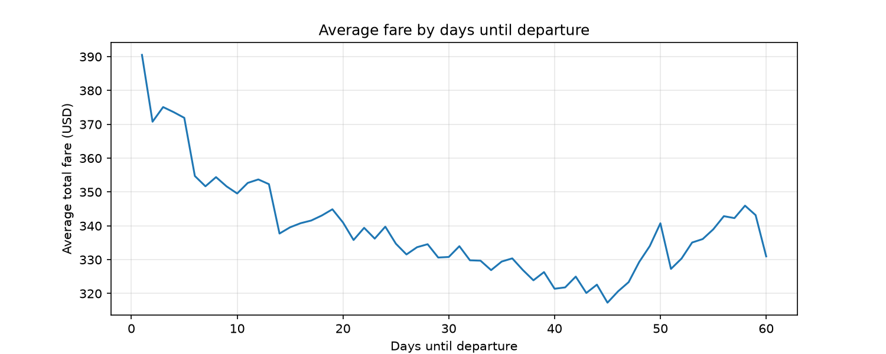

# ✈️ Buy Now or Wait? Predicting Flight Prices and Price Drops

**Status:** 🚧 In progress (expected completion: November 2026)

## Overview
Airfare changes constantly, which makes it hard to know the best time to buy a ticket. This project uses machine learning to predict U.S. domestic flight prices and to tell a traveler whether to **buy now** or **wait** for a price drop.

## Goals
1. **Predict ticket prices** with multiple linear regression
2. **Recommend when to buy** with logistic regression: label each search **"wait"** (1) if the same flight's price drops within the next 7 days, and **"buy now"** (0) otherwise

## Dataset
**[Flight Prices](https://www.kaggle.com/datasets/dilwong/flightprices)** (Kaggle)
- One-way U.S. domestic fares listed on Expedia, searched between April 16 and October 5, 2022
- **82,138,753 rows** and **27 columns** (~31 GB), covering **5,999,739 unique itineraries** from 16 major U.S. airports
- Each itinerary is observed on about 14 search dates, so the price of the same flight can be tracked over time

> The dataset is too large to store on GitHub. Download `itineraries.csv` from Kaggle and place it in the project folder.

## Approach
- **Handling a 31 GB file:** DuckDB scans the full CSV without loading it into memory; pandas is used on smaller samples
- **Modeling data:** 5–10 popular routes, keeping every search for those routes
- **Feature engineering:**
  - Days until departure (flight date − search date) and its square
  - Travel duration converted to minutes
  - Seats remaining, nonstop, basic economy
  - z-score scaling
- **Validation:** time-based train/test split (earlier searches train, later searches test) with a 7-day gap to avoid data leakage
- **Models:** both trained with gradient descent, with regularization
  - Linear regression to predict total fare
  - Logistic regression to classify "buy now" vs. "wait"
- **Evaluation:**
  - Regression: MAE and RMSE vs. a baseline that predicts each route's median fare
  - Classification: misclassification rate, precision, recall, and F1 vs. an "always buy now" baseline

## Early Findings
From exploratory analysis of a 1% random sample (821,388 rows):
- Fares are strongly **right-skewed** (mean 340 USD, median 306 USD, skew 2.02); the log of the fare is much closer to symmetric
- Average fare is highest for last-minute purchases (~390 USD one day out) and lowest around **45 days** before departure (~317 USD)



## Project Structure
```
flight-price-prediction/
├── 01_dataset_overview.ipynb   # dataset size, structure, and first exploration
├── figures/                    # saved plots
├── .gitignore
└── README.md
```

## Tools
Python · pandas · NumPy · DuckDB · scikit-learn · Matplotlib · Jupyter (Anaconda)

## Results
*Coming soon.*

## Author
**Anita Roese**, Computer Science, Xavier University of Louisiana
[LinkedIn](https://linkedin.com/in/anitaroese) · [GitHub](https://github.com/anitaroese)
